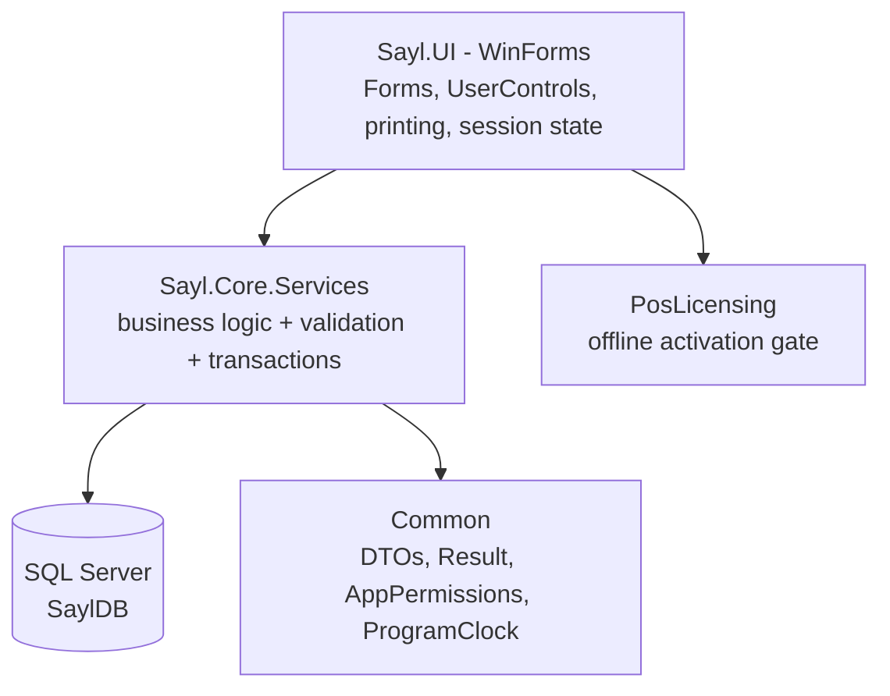

# SaylPOS

SaylPOS is a Windows Forms Point-of-Sale and business management system for retail and
supermarket operations. It runs entirely on the shop's own Windows machine with a local
SQL Server database — there is no external server and no cloud dependency. The
application covers sales, purchasing, batch-tracked inventory, customers and suppliers,
payments, returns, expenses, payroll, fiscal-year closing, backup/restore, and
role-based permissions.

The user interface is Arabic-first (RTL) with an English switch.

> **Status:** a working single-machine POS application under active development. This
> README describes the implementation as it exists today; known gaps are listed under
> [Known limitations](#known-limitations).

## Purpose

Small retail businesses need the operational depth of a full POS system — batch/lot
control with expiry tracking, receivables, payroll, and year-end closing — without the
overhead of a hosted service. SaylPOS addresses this by keeping all data on the
merchant's machine:

- **Data ownership** — every record lives in the local `SaylDB` database.
- **Offline operation** — nothing in the daily workflow requires internet access.
- Backup, guarded restore with a mandatory pre-restore safety copy.
- **Shared access on site** — the installer can configure an additional PC to connect
  to the main machine's SQL Server instance over the LAN (an installation role, not a
  separate server application).

## Main features

| Area | Features |
|---|---|
| Point of sale | Live product search, barcode scanning, mixed payments (cash/card/credit) with change calculation, suspended invoices with stock reservation and resume, daily cash-drawer sessions with Z-report reconciliation, thermal receipt printing (ESC/POS, CP1256), optional customer display |
| Inventory | Batch/lot tracking with expiry dates, FEFO consumption, quarantine of unsellable stock, manual stock receive, adjustments, batch transfer, physical stock counts with idempotent posting |
| Purchasing | Purchase invoices with per-batch costing and discount allocation, supplier returns, supplier payments |
| Returns | Customer and supplier returns linked to original invoices, exact proportional refunds, stock restored to original batches or quarantined |
| Parties | Unified customer/supplier records, balances, credit limits, collections and payments |
| Money | Invoice payments, general collections with deterministic oldest-first allocation, expenses, payroll (hourly/daily/monthly) with linked expense records |
| Reporting | Daily sales, inventory status, profit (COGS), product/customer profitability, top sellers, debt ageing, cash flow, sales trend, expiring batches, dashboard — with PDF (QuestPDF) and Excel (ClosedXML) export |
| Governance | Fiscal-year readiness checks and closing with history protection, role-based permissions (bitmask), audit log (`SystemLogs`), backup/restore |
| Licensing | Offline per-device activation with RSA-2048 signatures bound to a hardware fingerprint |

## Technology stack

| Component | Technology |
|---|---|
| Runtime | .NET 10 (`net10.0`; WinForms projects target `net10.0-windows`) |
| Language | C# |
| UI | Windows Forms (WinForms) — Windows only |
| Data access | Entity Framework Core 10 (`Microsoft.EntityFrameworkCore.SqlServer` 10.0.10) |
| Database | SQL Server (Express named instance in production installs; LocalDB for tests) |
| Password hashing | BCrypt.Net-Next 4.2.0 |
| PDF / Excel / Charts | QuestPDF 2026.8.0, ClosedXML 0.104.2, LiveChartsCore.SkiaSharpView.WinForms 2.0.5 |
| Testing | xUnit 2.9.2 with real-database integration tests on LocalDB |
| Licensing | Custom offline RSA-2048 library (`PosLicensing`) |
| Installer | Inno Setup (`installer/setup.iss`) |

## Architecture overview

The application is a single WinForms process talking directly to SQL Server. Business
logic and data access live in one service layer (`Sayl.Core.Services`); there is no
separate repository layer, no API, and no stored procedures. All service operations
return a `Result` / `Result<T>` object, and every state-changing operation enforces
permissions at the service boundary.



A full description — layer responsibilities, transaction and locking strategy, data
flows, and the database schema — lives in the [documentation](#documentation).

## Main modules

| Module | Responsibility |
|---|---|
| POS (`PosForm`) | Cashier sales, suspend/resume, drawer sessions, receipt printing |
| Dashboard | KPIs, inventory valuation, low-stock and expiring-batch indicators |
| Products | Catalog, barcodes, batches, net-available quantity |
| Inventory | Receive, adjust, batch transfer, physical stock counts |
| Customers / Suppliers | Party records, balances, credit limits, collections/payments |
| Invoices | Sales and purchase invoice browsing, details, printing |
| Expenses | Operational costs with fiscal-year protection |
| Reports | Sales, profit, profitability, debt ageing, cash flow |
| Employees & Payroll | Staff records, shifts, holidays, payroll generation and payment |
| Users & Roles | Accounts, password policy, permission bitmask |
| Settings | Store info, fiscal year, backup/restore |
| Fiscal year | Close wizard with readiness checks |

## Database overview

`SaylDB` contains 24 tables — no stored procedures, functions, triggers, or views.
Concurrency-critical rules are enforced twice: in the service layer (transactions,
`sp_getapplock` named locks, CAS-style conditional updates) and by the database itself
(filtered unique indexes and CHECK constraints). Highlights:

- `Batches.UnitCost` stores the per-batch acquisition cost — the source of COGS.
- `StockMovements` is an append-only audit log with `SourceType`/`SourceId`
  provenance; stock-count posting uses `SourceId = CountId` as an idempotency key.
- `Invoices` is a unified header for sales, purchases and returns; returns are stored
  with negative amounts and an `OriginalInvoiceId` link.
- `Payments` is the single cash ledger, attributed to a drawer session for Z reports.

See [docs/database/DATABASE_OVERVIEW.md](docs/database/DATABASE_OVERVIEW.md),
[docs/database/ENTITY_RELATIONSHIPS.md](docs/database/ENTITY_RELATIONSHIPS.md) and
[docs/database/STORED_PROCEDURES.md](docs/database/STORED_PROCEDURES.md).

## Authentication and authorization

Users sign in with username + password (BCrypt hashes); each user has one role holding
a permission bitmask over 12 administrative screens. Three fixed roles are seeded
(administrator `4095`, accountant `508`, cashier `0`); custom roles are capped below
the Roles screen. The UI hides unauthorized screens, but the real gate is a permission
check at the start of every state-changing service operation. Cash-bearing operations
additionally validate drawer-session ownership, and sensitive actions write to
`SystemLogs`.

See [docs/security/AUTHENTICATION_AND_AUTHORIZATION.md](docs/security/AUTHENTICATION_AND_AUTHORIZATION.md).

## Prerequisites

- Windows 10 or later (the app is a WinForms executable).
- .NET SDK 10 to build from source; the .NET 10 Desktop Runtime to run a built binary.
- SQL Server (Express, Developer, or LocalDB) reachable from the machine — the
  installer provisions an Express named instance; LocalDB is sufficient for
  development and tests.
- `sqlcmd` (SQL Server command-line utilities) for manual database initialization.

## Installation and setup

Two paths are supported.

**End-user installer (recommended for shop machines):**

1. Build the installer with `installer/build-installer.ps1` or use a prepared build.
2. Run the Inno Setup wizard and choose a role:
   - **MAIN** — installs the application, auto-installs SQL Server Express if no
     database engine is present, creates `SaylDB`, and optionally seeds demo data.
   - **TERMINAL** — configures an additional PC to connect to the main machine's
     instance over the LAN.

**Developer setup (from source):**

1. Install the .NET 10 SDK and a SQL Server instance (LocalDB is sufficient).
2. Initialize the database (next section).
3. Configure `Sayl.UI/appsettings.json` (next section).
4. Build and run (next section).

## Database initialization

All scripts live in the repository root and run with `sqlcmd`, for example:
`sqlcmd -S <server> -d <database> -i <script>`.

| Script | When to run |
|---|---|
| `SaylDB.sql` | **Fresh installs only.** Creates the database, all tables, constraints, indexes and minimal seed data. A safety gate aborts the script if any table already exists; it contains no `DROP` statements. |
| `DataSeed.sql` | Optional demo data. **It deletes existing data in the target database first** — run it only on a fresh database. |
| `Upgrade_09_SaylLeastPrivilege.sql` | Terminal deployments that need a least-privilege SQL login. |
| `Upgrade_10_PartyEmailNullableUnique.sql` | Older databases: filtered unique email on `Parties`. |
| `Upgrade_11_BatchUnitCost.sql` | Older databases: `Batches.UnitCost` plus backfill. |
| `Upgrade_12_StockCountCountedAt.sql` | Older databases: count-line snapshot columns and the open-count unique index. |
| `Upgrade_13_StockCountPostedMovementId.sql` | Older databases: posting idempotency column and filtered movement index. |
| `Upgrade_15_UtcDefaults.sql` | Older databases: technical timestamp column defaults become UTC. **Not applied automatically at startup** — run it manually (see below). |

In addition, the application applies three idempotent schema upgrades automatically at
startup (`EnsureSchemaUpgradesAsync`, `EnsureReservationSchemaAsync`,
`EnsureCountSchemaAsync`), so a database created by an older `SaylDB.sql` is brought
forward on first launch — these cover `Upgrade_10` through `Upgrade_14`
(`Upgrade_14_SystemLogsUserIdNullable.sql` has no manual step). On a database with
zero active users, the app creates the default `admin` account and forces a password
change at first sign-in.

### Applying `Upgrade_15_UtcDefaults.sql` (existing databases only)

```text
sqlcmd -S <server> -d <database> -i Upgrade_15_UtcDefaults.sql
```

For example, on the standard local install:
`sqlcmd -S .\SAYL -d SaylDB -i Upgrade_15_UtcDefaults.sql`.

- **A database created from the current `SaylDB.sql` already has UTC defaults** —
  skip this script on fresh installs.
- **An older existing database requires this upgrade script.** It is the one upgrade
  not covered by the automatic startup path above.
- **Timestamp defaults only.** The script replaces column `DEFAULT` constraints
  (`GETDATE()` → `SYSUTCDATETIME()`, same constraint names). It does not modify any
  stored historical timestamp values — historical data was already converted to UTC
  by `Upgrade_08` (VULN-45), and the application writes UTC explicitly. The script is
  idempotent: reruns are no-ops.
- **Take a backup first**, e.g. via the application's backup feature or:

  ```text
  sqlcmd -S <server> -Q "BACKUP DATABASE [SaylDB] TO DISK = N'C:\Backups\SaylDB_pre_upgrade15.bak' WITH INIT"
  ```

## Configuration

The application reads `appsettings.json` from the directory next to the executable
(`Sayl.UI/appsettings.json` in a source checkout). Never commit real credentials;
use placeholders and fill them in locally.

```json
{
  "ConnectionStrings": {
    "SaylDb": "Server=<YOUR_SERVER>;Database=SaylDB;Trusted_Connection=True;TrustServerCertificate=True"
  },
  "Language": "ar"
}
```

| Key | Meaning |
|---|---|
| `ConnectionStrings:SaylDb` | SQL Server connection string. Trusted (Windows) authentication is the supported configuration; a SQL login would use the usual `User Id=`/`Password=` keys — store such values only outside version control. |
| `Language` | Default UI language (`ar` or `en`); the user's saved preference in `%LocalAppData%` overrides it after the first switch. |

Error logs are written to `%LocalAppData%\Sayl_POS\ui-error.log`.

## Build and run

This is a Windows Forms application — it builds and runs on Windows only.

```powershell
# from the repository root
dotnet build Sayl_POS.slnx -c Release

# run the application
dotnet run --project Sayl.UI -c Release
```

The main solution file is `Sayl_POS.slnx` (XML solution format).

## Tests

```powershell
dotnet test Sayl.Tests\Sayl.Tests.csproj
```

The test suite is integration-style: it runs against real SQL Server (LocalDB) and
exercises the actual service layer and schema.

- **Isolated per-run databases.** Each run creates a uniquely named database
  (`SaylCogsTest_<hex>`), applies `SaylDB.sql` plus the upgrade scripts, and drops it
  afterwards. Parallel runs and CI do not collide, and leftover databases from
  previous runs are cleaned up by prefix.
- **Destructive-operation gates.** The test fixture only ever drops databases whose
  names carry the test prefix; it refuses to touch anything else
  (`DatabaseFixtureSafetyTests` covers these gates). This exists because an earlier
  version of the schema script destroyed a live database.
- **Restore is not exercised end-to-end** — it is destructive by design; only its
  authorization gate and pre-checks are tested.

**Console QA harness** (`consol app`): runs full usage cycles through the real service
layer. By default it targets an isolated scratch database (`SaylQAScratch_<unique>`)
built from `SaylDB.sql` + `DataSeed.sql` and dropped at exit. Options:

```text
dotnet run --project "consol app"            # scratch database (default, safe)
dotnet run --project "consol app" -- --keep-db   # keep the scratch database for inspection
dotnet run --project "consol app" -- --live  # explicit opt-in to write the REAL SaylDB
                                             # (requires confirmation unless --yes is passed)
```

## Project structure

```text
Sayl_POS/
├── Sayl_POS.slnx              # solution (XML format)
├── SaylDB.sql                 # full schema script (fresh installs only)
├── DataSeed.sql               # demo data (deletes existing data first)
├── Upgrade_09..13_*.sql       # idempotent migration scripts
├── Common/                    # shared contracts (net10.0)
│   ├── DTOs/                  #   request models + view models
│   ├── Enums/  Results/       #   enums, Result / Result<T>
│   └── Utils/                 #   AppPermissions, ProgramClock, validation
├── Sayl_DataAccess/           # Sayl.Core project (net10.0)
│   ├── Data/SaylDbContext.cs  #   EF Core model (24 DbSets)
│   ├── Models/                #   entities
│   └── Services/              #   23 registered services + static helpers
├── DependencyInjection/       # AddSaylServices registration (net10.0)
├── Sayl.UI/                   # WinForms frontend (net10.0-windows, WinExe)
│   ├── Forms/                 #   login, POS, main shell, ~30 task dialogs
│   ├── UserControls/          #   one per MainForm section
│   └── Infrastructure/        #   navigation, session state, theming,
│                              #   PDF/Excel/receipt/label printing, licensing gate
├── PosLicensing/              # offline RSA-2048 HWID-bound licensing library
├── KeygenTool/                # vendor-only license issuer (never shipped)
├── Sayl.Tests/                # xUnit integration tests (LocalDB)
├── consol app/                # console E2E QA harness (scratch DB by default)
├── installer/                 # Inno Setup script + build script
└── docs/                      # technical documentation (see below)
```

The top-level `Services/` folder is legacy leftover code that is not part of the
solution and not referenced by the application.

## Important design decisions

- **Batch costing / FEFO.** Consumption order is First-Expiry-First-Out (excluding
  expired and quarantined batches), but cost is read from each consumed batch
  (`Batches.UnitCost`), not from the product's last-purchase price. A sale line that
  consumed several batches is split into one `InvoiceItem` row per batch.
  See [docs/COSTING.md](docs/COSTING.md).
- **Weighted-average cost merging.** Adding quantity to an existing batch (purchase,
  manual receive, transfer) merges costs by quantity-weighted average; a batch with
  no stored cost falls back to `Product.CostPrice` — a documented reserve, never an
  invented figure.
- **Idempotent stock-count posting.** Each posting adjustment writes
  `StockMovements.SourceType = 'ManualAdjustment'` with `SourceId = CountId`; before
  posting, the service checks the database for an existing movement with that key, so
  a partial failure is always safe to retry. `StockCounts.PostedMovementId` records
  the link permanently.
- **Result error pattern.** Services return `Result` / `Result<T>` with user-facing
  messages; exceptions are internal plumbing converted to failed results at the
  operation boundary.
- **Service-boundary authorization.** The UI hides unauthorized screens, but every
  state-changing service operation independently verifies the actor's role bitmask,
  so UI visibility is never the enforcement point (see the actor-identity limitation
  below).
- **UTC + fixed-offset program day.** Transactional timestamps are stored in UTC
  (`DateTime.UtcNow`, `GETUTCDATE()`); the "shop day" used by reports, FEFO expiry,
  and fiscal boundaries is UTC + 3 (`Common.Utils.ProgramClock`), deliberately not
  the machine's local time zone.
- **App locks and CAS updates.** Cross-request serialization uses
  `sp_getapplock` (stock-count open/post); state transitions use conditional
  UPDATEs that succeed only from the expected previous state.
- **No stored procedures.** All logic lives in C#; the schema script is a pure
  table/index/constraint definition. See
  [docs/database/STORED_PROCEDURES.md](docs/database/STORED_PROCEDURES.md).

## Known limitations

- **Client-supplied actor identity (audit finding A3).** Service methods receive the
  acting user's id as a parameter. Within the supported single-machine (or
  trusted-LAN) deployment the application process is the trust boundary; a
  multi-terminal or server-hosted design would need authenticated identity first.
- **`Roles.RoleId` is `TINYINT IDENTITY`** — a maximum of 255 roles; a production
  schema follow-up.
- **Legacy column defaults were `GETDATE()`**; all technical timestamp defaults
  are now UTC (`SYSUTCDATETIME()`) via `Upgrade_15_UtcDefaults.sql` (fresh installs
  get them from `SaylDB.sql` directly).
- **No successful RESTORE in automated tests** — restore is destructive by design;
  only its authorization gate and pre-checks are covered.
- **Denied authorization attempts are not audited** — failures are returned but not
  written to `SystemLogs`.
- **Direct SQL access is possible by design** — the database holds no procedures or
  security layer; protection relies on the application and on Windows/database login
  permissions.
- **Windows only.** WinForms and SQL Server tooling tie the project to Windows.
- **In-memory login lockout.** Failed-attempt lockout state resets when the process
  restarts.

## Documentation

Detailed technical documentation lives in `docs/`:

| Document | Content |
|---|---|
| [docs/architecture/SYSTEM_ARCHITECTURE.md](docs/architecture/SYSTEM_ARCHITECTURE.md) | Architecture, startup, navigation, transactions, limitations |
| [docs/architecture/LAYER_RESPONSIBILITIES.md](docs/architecture/LAYER_RESPONSIBILITIES.md) | Layer map and full service catalog |
| [docs/architecture/DATA_FLOW.md](docs/architecture/DATA_FLOW.md) | Sequence diagrams for all main operations |
| [docs/database/DATABASE_OVERVIEW.md](docs/database/DATABASE_OVERVIEW.md) | Tables, constraints, indexes, migrations |
| [docs/database/ENTITY_RELATIONSHIPS.md](docs/database/ENTITY_RELATIONSHIPS.md) | ER model and integrity rules |
| [docs/database/STORED_PROCEDURES.md](docs/database/STORED_PROCEDURES.md) | Why none exist; where data-level logic lives |
| [docs/workflows/SALES_WORKFLOW.md](docs/workflows/SALES_WORKFLOW.md) | POS checkout, suspended invoices |
| [docs/workflows/PURCHASE_WORKFLOW.md](docs/workflows/PURCHASE_WORKFLOW.md) | Purchase invoices, batch intake, supplier balance |
| [docs/workflows/INVENTORY_WORKFLOW.md](docs/workflows/INVENTORY_WORKFLOW.md) | Receive, adjust, transfer, reservations |
| [docs/workflows/STOCK_COUNT_WORKFLOW.md](docs/workflows/STOCK_COUNT_WORKFLOW.md) | Physical counts and idempotent posting |
| [docs/workflows/PAYMENTS_AND_RETURNS.md](docs/workflows/PAYMENTS_AND_RETURNS.md) | Allocation engine, drawer sessions, returns |
| [docs/workflows/FISCAL_CLOSING.md](docs/workflows/FISCAL_CLOSING.md) | Readiness checks and the annual close |
| [docs/workflows/BACKUP_AND_RESTORE.md](docs/workflows/BACKUP_AND_RESTORE.md) | Backup strategy and guarded restore |
| [docs/security/AUTHENTICATION_AND_AUTHORIZATION.md](docs/security/AUTHENTICATION_AND_AUTHORIZATION.md) | Login, roles, permission evaluation, audit |
| [docs/COSTING.md](docs/COSTING.md) | Batch costing policy in depth |

## Contributing

Contributions are welcome. Before writing code, read
[Agent.md](Agent.md) — it defines the architecture rules for this repository
(single-layer services, `Result` pattern, permission checks at the service boundary,
UTC+3 program-day convention) and the working rules agents and contributors are
expected to follow: no unnecessary layers, no unrelated refactoring, no weakening of
tests to make builds pass, and documentation updates whenever architecture or
behavior changes. When a change requires a database modification, propose the schema
change in an idempotent `Upgrade_*.sql` script before touching code.


