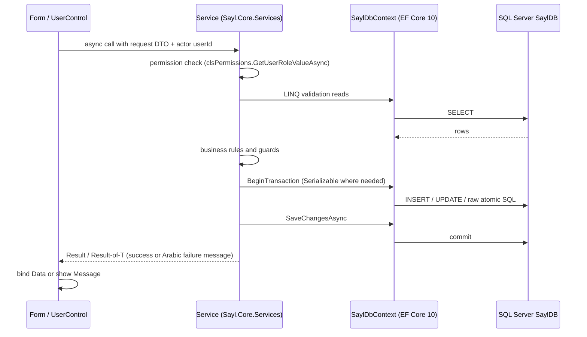
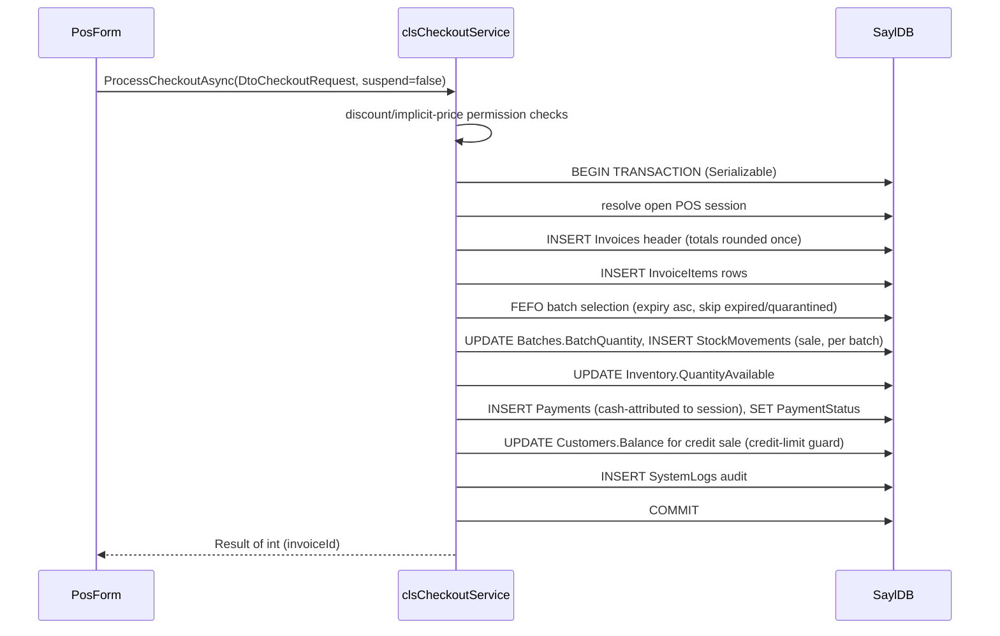
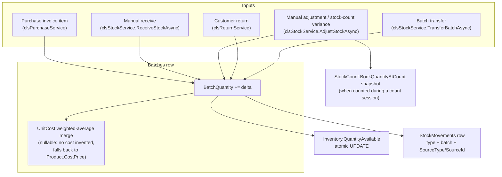
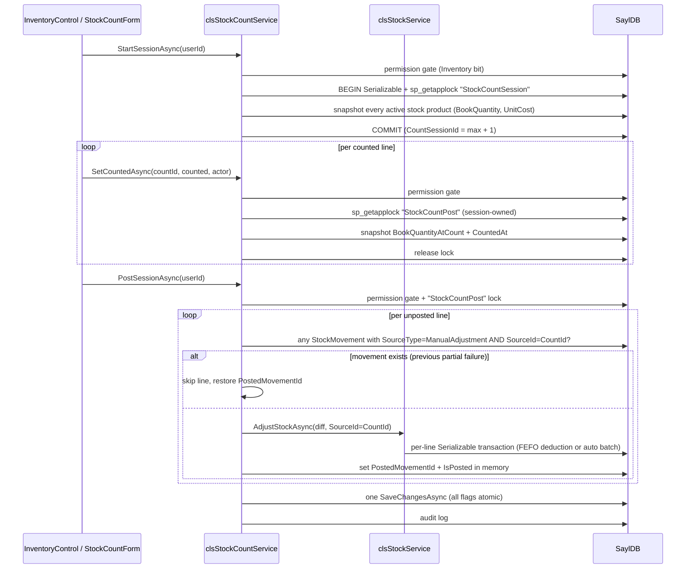
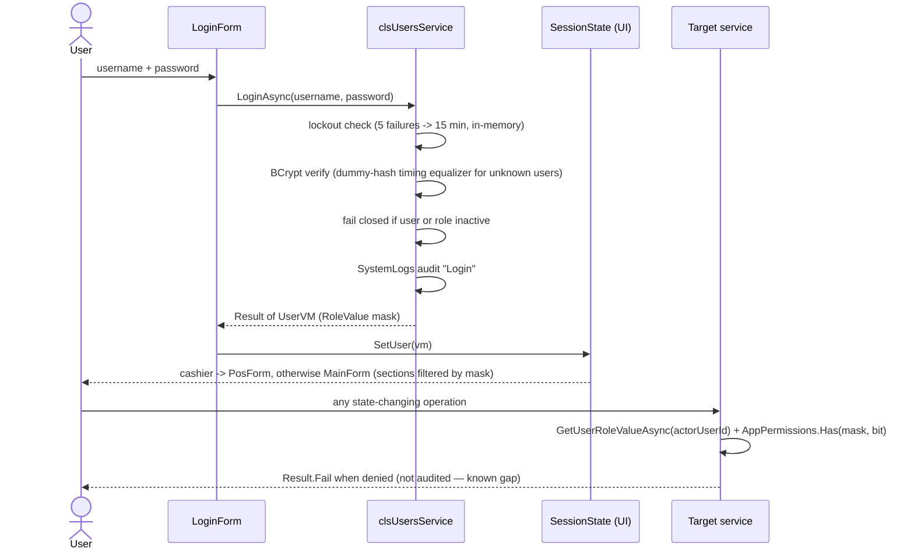

# Data Flow — SaylPOS

Sequence diagrams for the main operation flows. Each diagram reflects the current
implementation on the `bug-fixes` branch.

## 1. Typical Operation Flow (UI → service → DAL → SQL)



## 2. Sales and Payment Workflow



Failure paths: any guard throw rolls back the whole transaction; SQL deadlock (1205)
is retried up to 3 times; parallel sell against the same stock is blocked by the
Serializable re-check of availability.

## 3. Inventory Receipt and Stock Movement



Cost rules (see [COSTING.md](../COSTING.md)):

- COGS is read from the consumed batch (`Batches.UnitCost`), never from
  `Product.CostPrice` directly.
- Merging quantity into an existing batch (purchase, manual receive, transfer)
  applies a quantity-weighted average of the batch cost.
- A batch with no stored cost falls back to `Product.CostPrice` at sale time —
  the documented reserve; no alternative cost is invented.
- A sale line that consumed several batches is split into one `InvoiceItem` row per
  batch, each with its own `ItemCost`.

## 4. Stock Count and Posting (with idempotency)



Idempotency contract:

- Every posting adjustment writes `StockMovements.SourceType = 'ManualAdjustment'`
  with `SourceId = CountId` — a permanent idempotency key (multiple movements per
  line are legitimate for FEFO shortages, hence a filtered non-unique index,
  `IX_StockMovements_ManualAdjustmentSource`, not a unique constraint).
- Before posting a line, the service checks the database (not memory) for an
  existing movement with that key; found movements are linked into
  `StockCounts.PostedMovementId` and the line is skipped.
- All `IsPosted` / `PostedMovementId` flags are saved in one `SaveChangesAsync`,
  so a mid-run failure leaves recovered lines marked and retriable without any
  double adjustment.
- A filtered unique index (`UQ_StockCounts_OpenProduct`, `WHERE IsPosted = 0`)
  prevents two open count sessions for the same product.

## 5. Backup and Restore

```mermaid
sequenceDiagram
    actor Admin
    participant UI as SettingsControl
    participant BK as clsBackupService
    participant DB as SQL Server

    Admin->>UI: request backup
    UI->>BK: BackupAsync(folder, keepLast=30)
    BK->>DB: grant write ACL to SQL service account (icacls, best effort)
    BK->>DB: BACKUP DATABASE ... TO DISK
    BK->>BK: cleanup old .bak files (intends to keep pre-restore copies; see BACKUP_AND_RESTORE.md)

    Admin->>UI: request restore (Settings permission required)
    UI->>BK: RestoreAsync(path, actorUserId)
    BK->>DB: authorization gate: active user + AppPermissions.Settings
    BK->>DB: refuse if any POS session is open
    BK->>DB: audit "RestoreDatabase" start record
    BK->>DB: mandatory pre-restore BACKUP (suffix pre-restore)
    BK->>DB: ALTER DATABASE SET SINGLE_USER WITH ROLLBACK IMMEDIATE
    BK->>DB: RESTORE DATABASE ... WITH REPLACE, RECOVERY (MOVE to current file paths)
    BK->>DB: ALTER DATABASE SET MULTI_USER
    BK->>DB: audit "RestoreDatabaseCompleted" (best effort)
    BK-->>UI: Result of string
```

Notes:

- Restore is deliberately destructive; automated tests cover the authorization gate
  and pre-checks only — no successful RESTORE is exercised in tests.

## 6. Authentication / Authorization Flow

See [AUTHENTICATION_AND_AUTHORIZATION.md](../security/AUTHENTICATION_AND_AUTHORIZATION.md)
for the full policy; the condensed flow:




