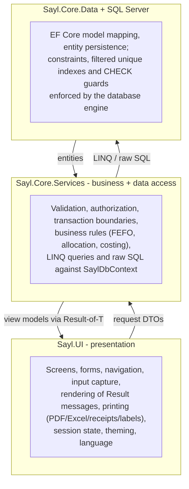

# Layer Responsibilities — SaylPOS

SaylPOS uses a pragmatic three-tier shape with a deliberately thin boundary between
business logic and data access. This page states exactly which layer owns which
responsibility, and lists every service class with its role.

## 1. Responsibility Map

| Concern | Owner | Notes |
|---|---|---|
| UI layout, input, navigation | `Sayl.UI` | Forms + UserControls; RTL, Arabic-first via `AppLang` |
| Input validation (format) | Mostly `Sayl.Core.Services` | Service guards are authoritative; UI validation is convenience only |
| Business rules | `Sayl.Core.Services` | FEFO ordering, discount allocation, payment allocation, costing, fiscal guards |
| Authorization | `Sayl.Core.Services` | `clsPermissions` + `AppPermissions` bitmask; UI hides screens cosmetically |
| Transactions | `Sayl.Core.Services` | Per-operation EF Core transactions + app locks + CAS updates |
| Persistence | EF Core 10 over `SaylDbContext` | No stored procedures; see [STORED_PROCEDURES.md](../database/STORED_PROCEDURES.md) |
| Referential integrity, amount guards | SQL Server | CHECK constraints and filtered unique indexes are the last line of defense |
| Cross-cutting time | `Common.Utils.ProgramClock` | UTC storage; program day = UTC+3 |

## 2. Common (shared contracts)

- `DTOs/RequestModels` — `DtoCheckoutRequest`, `DtoPurchaseRequest`,
  `DtoStockReceiveRequest`, `DtoStockAdjustmentRequest`, `DtoReturnRequest`,
  `DtoPaymentRequest`, `DtoBatchTransferRequest`, `DtoNewUserRequest`.
- `DTOs/ViewModel` — screen models (`InvoiceVM`, `DashboardSummaryVM`,
  `InventoryStatusVM`, `PaymentVM`, `StockCountVM`, and others).
- `Results` — `Result` and `Result<T>`: `IsSuccess`, `Message`, optional `Data`.
- `Utils` — `AppPermissions` (bitmask contract), `ProgramClock` (UTC+3 program day),
  `clsValidation`, `clsCompare`.
- `Enums` — invoice type/status, payment type/status, stock-movement type, POS
  session status, salary type, trend grouping.
- `Exceptions` — `NotFoundException`, `ConflictException` (typed failure helpers).

## 3. Sayl.Core (folder `Sayl_DataAccess`)

### 3.1 Data

`SaylDbContext` maps 24 tables to entities in `Sayl.Core.Models`, configures keys,
unique/filtered indexes, string lengths, decimal precision and default values, and
exposes the `OnModelCreatingPartial` hook. It is registered as **scoped** — each
service operation runs on the scoped context instance of its DI scope.

### 3.2 Service catalog

| Service | Responsibility |
|---|---|
| `clsUsersService` | Login/logout, password policy and change/reset, user CRUD, default-admin bootstrap, schema upgrade SQL |
| `clsRoleService` | Role CRUD; protects the three fixed roles; enforces the custom-role ceiling |
| `clsPermissions` / `clsAudit` | Static helpers: role-value lookup, drawer-session validation, `SystemLogs` audit writes |
| `clsProductService` | Product CRUD, barcode lookup, batch listing, net-available quantity (`batches − expired/quarantined − reserved`) |
| `clsStockService` | Manual stock receive, FEFO sell, manual adjustment (in/out with batch granularity), batch transfer with cost merge |
| `clsStockCountService` | Physical count sessions: open snapshot, per-line counting with book-at-count snapshot, variance valuation, idempotent posting |
| `clsCheckoutService` | POS checkout (complete or suspend), suspended-invoice completion/cancellation, reservation lifecycle, COGS capture |
| `clsPurchaseService` | Purchase invoices: batch intake, discount allocation across items, weighted-average cost, supplier balance |
| `clsReturnService` | Customer and supplier returns: eligibility, proportional refunds, stock restoration/deduction |
| `clsInvoiceService` | Invoice lists/paging, details, print model |
| `clsPaymentService` | Invoice payments, general customer collection, supplier payment — all allocation-aware |
| `clsPaymentAllocation` | Static deterministic allocation engine: outstanding per invoice after returns, linked payments and oldest-first general-payment allocation |
| `clsPartyService` | Party CRUD (customers/suppliers/both), activate/deactivate, POS quick-add |
| `clsCustomerService` / `clsSupplierService` | Typed listings and paging over `Customers` / `Suppliers` |
| `clsExpenseService` | Expense CRUD with fiscal-year protection |
| `clsPayrollService` | Payroll generation (idempotent per period), editing, payment (creates a linked expense), reversal |
| `clsShiftService` | Shift definitions, employee-shift assignments (weekday bitmask), official holidays |
| `clsPosSessionService` | Open/close cash drawer sessions, expected-amount reconciliation (Z report) |
| `clsCashService` | In-session cash movements (paid in / paid out) |
| `clsReportService` | Daily sales, inventory status, profit summaries, periodic reports, top selling, dashboard, sales trend, expiring batches, product/customer profitability, debt ageing, cash flow |
| `clsFiscalYearService` | Fiscal-year start/close settings, close-readiness checks, annual close with CAS atomicity |
| `clsSettingsService` | Key/value `Settings` access |
| `clsBackupService` | `BACKUP DATABASE`, retention cleanup, guarded `RESTORE DATABASE` with pre-restore safety copy |

### 3.3 Service conventions

1. Constructor-injected `SaylDbContext` only — never passed as a method parameter.
2. All public operations return `Result` / `Result<T>`; Arabic user-facing messages.
3. Permission check is the first statement of every state-changing operation.
4. Multi-step writes run inside an explicit transaction; reads used for enforcement
   are repeated inside the transaction.
5. Raw SQL is used where atomicity requires it (increment, CAS) or where EF cannot
   express the operation (`BACKUP`/`RESTORE`, `sp_getapplock`, schema upgrades).

## 4. Sayl.UI

- `Forms/` — login, POS, main shell, and ~30 task dialogs.
- `UserControls/` — one control per `MainForm` section.
- `Infrastructure/` — `AppNavigator`, `SessionState`, `AppClock`, `AppLang`,
  `AppTheme`, `Brand`, `LicenseGate`, `PdfService` (QuestPDF), `ExcelService`
  (ClosedXML), `ReceiptPrinter`, `LabelPrinter`, `InvoicePrintHelper`, `UiHelpers`.
- `Controls/` — reusable widgets (confirmation dialog, pager, invoice format picker).

Printing responsibilities: `PdfService` renders reports and invoices to PDF,
`ExcelService` exports grids, `ReceiptPrinter` sends ESC/POS-style output to thermal
printers with CP1256 encoding, and `LabelPrinter`/`LabelPrintForm` handle shelf labels.

## 5. DependencyInjection

A single extension method, `AddSaylServices(IServiceCollection, string)`, registers:

- `AddDbContext<SaylDbContext>` with the SQL Server provider (debug-only verbose
  logging and sensitive-data logging).
- All 23 services as scoped.

There are no interfaces registered — the UI resolves concrete service classes. This
keeps the DI setup honest about the single-layer design (services are both business
and data access).

## 6. What Is Intentionally Not Here

- No repository/unit-of-work abstraction: the `DbContext` plus explicit transactions
  fill that role.
- No domain-model layer separate from EF entities: entities are simple persistence
  models with a few computed properties (for example `StockCount.Difference`).
- No server-side API: everything is in-process. Any future multi-terminal design
  would need to revisit the client-supplied actor identity first (see
  [SYSTEM_ARCHITECTURE.md §9](SYSTEM_ARCHITECTURE.md#9-known-limitations)).

