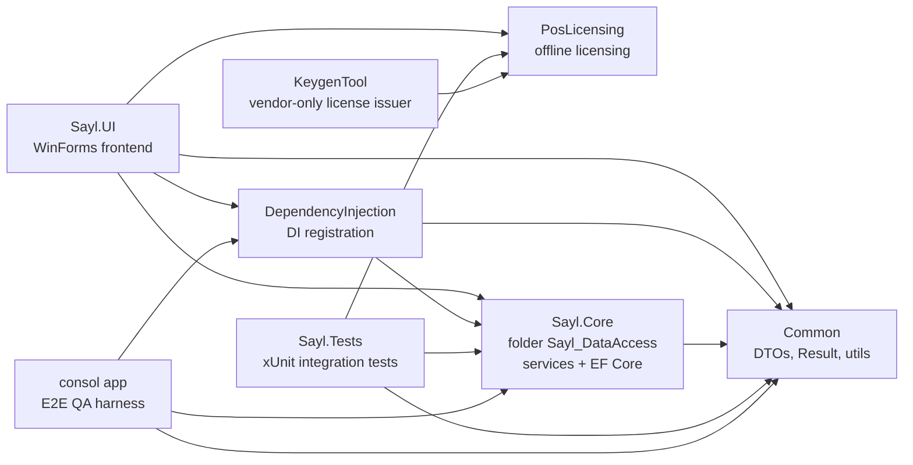

# System Architecture — SaylPOS

> Status: current as of the `bug-fixes` branch. This document describes the system as
> it is implemented today. Planned or historical ideas (a centralized server, a Web
> API, Windows Services) are **not** part of the implementation and are not covered
> here. The installer's TERMINAL role only points an extra PC at the host's SQL Server
> instance; the application itself remains a single-machine program.

## 1. What SaylPOS Is

SaylPOS is a Windows Forms Point-of-Sale and business management application for
retail and supermarket operations. It runs on .NET 10 with SQL Server (Express named
instance or LocalDB) accessed through Entity Framework Core 10. A single database
(`SaylDB`) is used directly by the application; there is no application server, no
API layer, and no message queue.

Functional scope:

| Domain | Capabilities |
|---|---|
| Sales | POS checkout, suspended invoices with stock reservation, customer returns |
| Purchasing | Purchase invoices with batch intake, supplier returns, supplier payments |
| Inventory | Batch/lot tracking, FEFO consumption, manual receive, adjustments, batch transfer, physical stock counts |
| Parties | Customers and suppliers (shared `Parties` base), balances, credit limits |
| Money | Invoice payments, general collections/payments with deterministic allocation, expenses, payroll, cash drawer sessions |
| Reporting | Daily/periodic sales, profit (COGS), product/customer profitability, debt ageing, cash flow, inventory status, expiring batches, dashboard |
| Governance | Fiscal-year readiness checks and closing, role-based permissions (bitmask), audit log, backup/restore |
| Distribution | Offline RSA-2048 HWID-bound licensing, Inno Setup installer (MAIN / TERMINAL roles) |

## 2. High-Level Architecture

```mermaid
flowchart TB
    subgraph UI["Sayl.UI - WinForms (net10.0-windows)"]
        PROG["Program.cs: startup, license gate, first-run owner setup"]
        NAV["AppNavigator (ApplicationContext): top-level form lifecycle"]
        MAIN["MainForm + 13 section UserControls"]
        FORMS["~30 task forms: POS, receive stock, purchase, returns, payments, payroll, fiscal close"]
        INFRA["Sayl.UI.Infrastructure: AppClock, AppLang, AppTheme, SessionState, PdfService, ExcelService, ReceiptPrinter, LabelPrinter, LicenseGate"]
    end

    subgraph SVC["Sayl.Core.Services - business logic + data access (one layer)"]
        SERVICES["23 registered services: clsCheckoutService, clsStockService, clsStockCountService, clsPurchaseService, clsReturnService, clsPaymentService, clsFiscalYearService, clsBackupService, and others"]
        PERM["clsPermissions and clsAudit helpers"]
    end

    subgraph DAL["Sayl.Core.Data - EF Core 10"]
        CTX["SaylDbContext: 24 DbSets, entities in Sayl.Core.Models"]
    end

    subgraph DB[("SQL Server - SaylDB")]
        TABLES["24 tables, filtered unique indexes, CHECK guards, no stored procedures"]
    end

    subgraph COMMON["Common - shared contracts"]
        DTOS["DTOs: request models and view models"]
        RES["Result and Result-of-T"]
        UTILS["AppPermissions, ProgramClock, clsValidation"]
    end

    PROG --> NAV --> MAIN
    MAIN --> FORMS
    FORMS --> SERVICES
    SERVICES --> PERM
    SERVICES --> CTX
    CTX --> TABLES
    SERVICES --> DTOS
    SERVICES --> RES
    SERVICES --> UTILS
```

Key characteristics:

- **Single-layer services.** Business logic and data access live in the same service
  classes (`Sayl.Core.Services`). There is no separate repository or business-manager
  layer. Each service receives `SaylDbContext` through its constructor.
- **DTO boundary.** EF entities are never exposed to the UI. Services accept request
  DTOs (`Common.DTOs.RequestModels`) and return view models (`Common.DTOs.ViewModel`).
- **Result pattern.** Every service operation returns `Result` or `Result<T>`.
  User-facing failures are expressed as `Result.Fail(...)` with an Arabic message;
  exceptions are used only for internal technical conditions and are converted to
  failed results at the operation boundary.
- **Authorization at the service boundary.** The UI hides unauthorized screens
  (cosmetic); the real gate is a permission check inside each service operation.
- **Transactions with app locks.** Multi-step operations run inside explicit EF Core
  transactions (Serializable where a read-check-write race matters) combined with
  `sp_getapplock` named locks and atomic CAS-style UPDATE statements.

## 3. Project Dependency Structure



Project responsibilities and targets:

| Project | Target | Role |
|---|---|---|
| `Common` | net10.0 | DTOs (request + view models), enums, `Result`, `AppPermissions`, `ProgramClock`, validation helpers |
| `Sayl.Core` (folder `Sayl_DataAccess`) | net10.0 | EF Core entities, `SaylDbContext`, all service classes. Packages: `BCrypt.Net-Next`, `Microsoft.EntityFrameworkCore.SqlServer` 10.0.10 |
| `DependencyInjection` | net10.0 | `AddSaylServices(connectionString)` — registers the DbContext and all services |
| `Sayl.UI` | net10.0-windows (WinExe) | WinForms frontend. QuestPDF (PDF), ClosedXML (Excel), LiveChartsCore (dashboard charts) |
| `PosLicensing` | net10.0-windows | Offline RSA-2048, machine-fingerprint-bound license validation |
| `KeygenTool` | net10.0-windows | Vendor-only WinForms tool that issues licenses. Never shipped to customers |
| `Sayl.Tests` | net10.0-windows | xUnit integration tests against LocalDB with randomized isolated test databases |
| `consol app` | net10.0 | E2E QA harness that drives full usage cycles through the real service layer |

Notes:

- The solution file is `Sayl_POS.slnx` (XML solution format) with solution items
  `Agent.md`, `SaylDB.sql`, `TASK.md`, `UI_TASK.md`.
- The top-level `Services/` folder is legacy leftover code (a console stub and an
  early `clsCustomersServices` prototype). It is **not referenced** by the solution
  and is not part of the running application.

## 4. Application Startup

`Sayl.UI/Program.cs` is the single entry point. The sequence is:

1. `ApplicationConfiguration.Initialize()` and registration of the Windows code-page
   encoding provider (CP1256 for Arabic thermal receipt printers).
2. Global exception handlers (`Application.ThreadException`,
   `AppDomain.UnhandledException`) append to `%LocalAppData%\Sayl_POS\ui-error.log`
   and show a visible error dialog — no silent failures.
3. Configuration is loaded from `appsettings.json` next to the executable: the
   `SaylDb` connection string and the default UI language.
4. `AppLang` initializes the UI language (user preference saved in `%LocalAppData%`,
   falling back to `appsettings.json`).
5. Dependency injection: `AddSaylServices(connectionString)` registers
   `SaylDbContext` (SQL Server provider) and all 23 services as scoped, plus
   transient forms (`LoginForm`, `MainForm`, `PosForm`, `AboutForm`,
   `ReceiveStockForm`).
6. **Licensing gate** (`LicenseGate.EnsureValidated`): offline activation is
   validated before anything else. Failures distinguish expiry, clock rollback and
   transient validation unavailability; without a valid activation the app exits.
7. **First-run owner setup** (`EnsureOwnerSetup`):
   - Idempotent schema upgrades run before any user query
     (`EnsureSchemaUpgradesAsync`, `EnsureReservationSchemaAsync`,
     `EnsureCountSchemaAsync`) so older databases are brought up to date.
   - With up to 6 retries (5 s apart) it waits for a SQL Server service that may
     still be starting right after installation.
   - If the database has zero active users, `EnsureDefaultAdminAsync` creates the
     default `admin` account with `MustChangePassword = 1`; the password must be
     changed at first sign-in. No interactive account-creation screen exists.
8. `AppNavigator` (an `ApplicationContext`) shows `LoginForm` and manages the
   top-level form lifecycle. After a successful login, navigation branches by role
   identity: a cashier (`RoleValue == 0`) goes directly to `PosForm`; every other
   role opens `MainForm`, whose section list is built from the role's permission
   bitmask.

## 5. WinForms Navigation and Interaction

- `AppNavigator` swaps top-level windows (login / main shell / POS) and disposes
  the previous form to avoid memory growth across login cycles.
- `MainForm` hosts a right-docked sidebar (RTL layout) and a content panel. Its
  13 sections are registered in `BuildSections`: Dashboard, Products, Inventory,
  Customers, Suppliers, Sales Invoices, Purchase Invoices, Expenses, Reports,
  Employees, Users, Roles, Settings. Each maps to a `UserControl` in
  `Sayl.UI/UserControls`.
- Visibility of each section is filtered by `SessionState.Can(bit)` against the
  logged-in user's role mask. Sections the role does not own are not created.
- Section lifecycle is "host" style: entering a section disposes the previous
  `UserControl` and instantiates a fresh one, so every section shows live data
  (a deliberate simplicity-over-caching trade-off).
- Task forms (receive stock, purchase, returns, payments, payroll, fiscal close,
  sessions, and similar) are modal dialogs opened from their parent section; they
  resolve services through `Program.Services.CreateScope()` per operation.
- UI localization runs through `AppLang` string tables; the UI is Arabic-first with
  an English switch, and the whole shell is `RightToLeft.Yes`.

## 6. UI-to-Business and Business-to-DAL Communication

- **UI to services:** forms and user controls create a DI scope, resolve the
  concrete service class, and call an async method with request DTOs. The actor
  identity is passed explicitly as a `userId` parameter (see
  [Limitations](#9-known-limitations)). Responses are `Result`/`Result<T>`; the UI
  renders `Message` on failure and binds `Data` on success.
- **Services to DAL:** services use `SaylDbContext` directly — LINQ queries for
  reads, tracked entities plus `SaveChangesAsync` for writes, and raw SQL
  (`ExecuteSqlInterpolatedAsync` / `ExecuteSqlRawAsync`) for atomic in-place
  updates, app locks, and server administration (backup/restore). EF Core
  translates the model configuration in `SaylDbContext.OnModelCreating`.

## 7. Transaction Handling and Concurrency

All multi-step service operations follow the same envelope:

```csharp
using var transaction = await _dbContext.Database.BeginTransactionAsync(IsolationLevel.Serializable);
try
{
    // validation, reads, writes
    await _dbContext.SaveChangesAsync();
    await transaction.CommitAsync();
}
catch
{
    await transaction.RollbackAsync();
    return Result.Fail("...");
}
```

Mechanisms in use:

| Mechanism | Where | Purpose |
|---|---|---|
| Serializable transactions | Checkout, sell, adjust, batch transfer, payments, returns, POS session close, stock-count start/post, fiscal close | Prevents read-check-write races (parallel oversell, over-payment, double posting) |
| `sp_getapplock` named locks | Stock-count open (`StockCountSession`, transaction-owned) and post (`StockCountPost`, session-owned) | Serializes stock-count operations across requests and app restarts |
| Atomic CAS-style UPDATE | Suspended invoice claim (status suspended to completed), POS session close, fiscal-year close, conditional batch decrement | First-writer-wins; concurrent duplicates see zero affected rows and fail safely |
| Raw SQL atomic increments | `Inventory.QuantityAvailable`, `Batches.BatchQuantity`, `Suppliers.Balance` | Parallel receive/purchase/pay operations never lose increments |
| Filtered unique indexes | One open POS session per user, one open count line per product, one reservation per (invoice, product), one account per employee | Database-level last line of defense |
| Unique-index catch-and-merge | Batch creation on receive/purchase/adjust/transfer (`UQ_Batches_Product_Batch`) | A parallel request that created the same batch converts the failure into an atomic quantity increase plus weighted-average cost merge |
| Deadlock retry loop | `clsCheckoutService.ProcessCheckoutAsync` (SQL error 1205, 3 attempts) | Deadlocks are retryable, not user errors |
| `UPDLOCK` balance reads | Customer/supplier payment collection | Parallel collectors wait instead of reading stale balances |

Two structural notes (documented limitations):

- The app-lock design serializes posting operations; `clsStockCountService` posts
  count-line adjustments by calling `clsStockService.AdjustStockAsync`, and each
  adjustment commits its own per-line transaction internally. A posting run is not
  one atomic transaction — idempotency (`PostedMovementId`) is what makes a partial
  failure safe to retry.
- Stock-count posting is therefore a sequence of independently committed
  adjustments; the atomic unit is one count line, not one count session.

## 8. Error Propagation

- Services return `Result` / `Result<T>` (`Common.Results`). `IsSuccess` plus an
  Arabic `Message` carry the outcome; `Data` carries payloads.
- Internal guard failures inside a transaction are thrown as
  `InvalidOperationException` and caught at the operation boundary, converted to
  `Result.Fail(ex.Message)` so the user sees the specific guard message.
- Expected database races (unique-index violations, deadlocks) are detected by
  constraint name / error number and handled by merge/retry logic, not surfaced
  as errors.
- `Common/Exceptions` contains `NotFoundException` and `ConflictException` for
  typed failures; `Common/Utils/clsValidation` and `clsCompare` carry small
  validation and comparison helpers.
- UI-level unexpected exceptions are logged to `%LocalAppData%\Sayl_POS\ui-error.log`
  and shown in a visible dialog; logging failures themselves never escalate.

## 9. Known Limitations

- **A3 — actor identity is client-supplied.** Every service method receives the
  acting user's `userId` as a parameter. In a single-machine trusted deployment this
  is acceptable; it is a design concern for any future multi-terminal or server
  setup and is flagged in the audit report.
- **`Roles.RoleId` is `TINYINT IDENTITY`** (max 255 roles) — a production schema
  follow-up.
- **Database column defaults are UTC** (`SYSUTCDATETIME()`, Upgrade_15) and all
  writers also stamp UTC (`DateTime.UtcNow` / `GETUTCDATE()`) — one clock domain
  across code and defaults. Business `DATE` columns (payment/expiry/fiscal) keep
  their local business meaning by design.
- **No successful RESTORE was exercised in the automated tests** — restore is
  destructive by design, so only its authorization and pre-checks are covered.
- **Denied authorization attempts are not audited** — authorization failures are
  returned to the caller but are not written to `SystemLogs`.

## 10. Where to Read Next

- [LAYER_RESPONSIBILITIES.md](LAYER_RESPONSIBILITIES.md) — per-layer responsibility
  map and the full service catalog.
- [DATA_FLOW.md](DATA_FLOW.md) — operation flow diagrams for the main workflows.
- [../database/DATABASE_OVERVIEW.md](../database/DATABASE_OVERVIEW.md) — schema,
  constraints and data-level rules.
- [../workflows/](../workflows/) — step-by-step business workflows.
- [../security/AUTHENTICATION_AND_AUTHORIZATION.md](../security/AUTHENTICATION_AND_AUTHORIZATION.md)
  - login, roles, permission evaluation.


