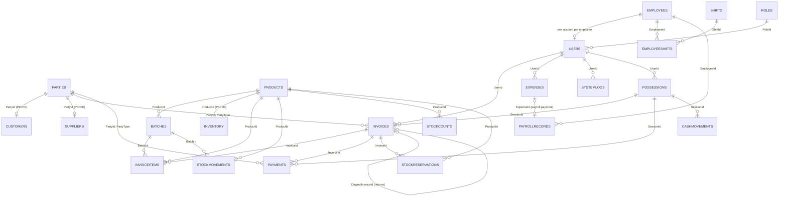

# Database Overview — SaylDB

Schema source of truth: [`SaylDB.sql`](../../SaylDB.sql) (fresh installs only — the
script aborts if any table already exists and contains no `DROP` statements), plus
the idempotent `Upgrade_09` … `Upgrade_13` scripts in the repository root.

- Engine: SQL Server (Express named instance `.\SAYL` in production installs;
  LocalDB for tests).
- Access: EF Core 10 (`SaylDbContext`) for application queries; raw SQL inside
  services for atomic updates, app locks and server administration.
- Stored procedures: **none** — see [STORED_PROCEDURES.md](STORED_PROCEDURES.md).

## 1. Time Policy (Program Clock)

All transactional timestamps are stored in UTC: `DateTime.UtcNow` from EF writes and
`GETUTCDATE()` in raw SQL. The "shop day" used by daily reports, FEFO expiry checks,
payment dates and fiscal boundaries is derived via `ProgramClock` (UTC + fixed +3 h).
Column defaults are `SYSUTCDATETIME()` (Upgrade_15; see §7).

## 2. Table Catalog

24 tables.

| Table | Responsibility |
|---|---|
| `Parties` | Base entity for every customer and supplier. `PartyType` = `C` / `S` / `B` |
| `Customers` | Customer extension: `Balance`, `CreditLimit` (PK = FK → `Parties`) |
| `Suppliers` | Supplier extension: `Balance`, `Category` (PK = FK → `Parties`) |
| `Employees` | Staff records, salary type (hourly/daily/monthly), status |
| `Roles` | Role name + `RoleValue` permission bitmask. `RoleId` is `TINYINT IDENTITY` |
| `Users` | Login accounts, BCrypt `PasswordHash`, optional `EmployeeId` link, `MustChangePassword` |
| `Products` | Stock items, services, manufactured goods. `BasePrice` (sell), `CostPrice` (last-purchase reference) |
| `Batches` | Lot control: batch number, expiry, quantity, `UnitCost` (acquisition cost — COGS source), `IsQuarantined` |
| `Inventory` | Per-product stock summary: available, reserved, `LastCountedAt` |
| `StockReservations` | Reservation ownership per (suspended invoice, product) |
| `Invoices` | Unified header for `sale`, `purchase`, `customer_return`, `supplier_return`; status, payment status, amounts, session and original-invoice links |
| `InvoiceItems` | Line items with `BatchId`, `ItemPrice`, `ItemCost` (effective unit cost) |
| `Payments` | `income`/`outcome` cash records linked to an invoice or a party; `SessionId` attributes the cash to a drawer |
| `StockMovements` | Immutable audit log of every stock change (`purchase`, `sale`, `customer_return`, `supplier_return`, `adjustment_in`, `adjustment_out`) with `SourceType`/`SourceId` provenance |
| `StockCounts` | Physical count lines: book snapshot, counted quantity, book-at-count snapshot, posting flags, `PostedMovementId` |
| `Expenses` | Operational costs; payroll payment creates a linked expense |
| `PayrollRecords` | Per-employee per-period payroll with a unique (employee, period) constraint |
| `Shifts`, `EmployeeShifts`, `OfficialHolidays` | Shift definitions, weekday-bitmask assignments, paid holidays |
| `POSSessions` | Cash drawer sessions: opening/closing/expected amounts |
| `CashMovements` | Paid-in/paid-out movements inside a session |
| `Settings` | Key/value configuration (store info, VAT, fiscal-year start, backup path) |
| `SystemLogs` | Audit trail (login, logout, sensitive operations) |

## 3. Keys and Relationships

Relationship notes:

- `Customers` / `Suppliers` share the `Parties` PK as their own PK (1:0..1).
- Return invoices are rows in `Invoices` with `Type` = `customer_return` /
  `supplier_return`, negative amounts by design, and `OriginalInvoiceId` pointing at
  the sale/purchase invoice they reverse.
- `Payments` is the single ledger for cash in/out, whether tied to an invoice
  (`InvoiceId`) or to a party balance (`InvoiceId = NULL`).
- `StockCounts.PostedMovementId` and `StockMovements.SourceId` form the stock-count
  idempotency pair; `PostedMovementId` has **no FK** (the movement may be written in
  a different transaction than the flag update).

## 4. Unique Constraints and Important Indexes

### Concurrency guards (filtered unique indexes)

| Index | Table | Rule |
|---|---|---|
| `UX_POSSessions_OneOpenPerUser` | `POSSessions` | One open drawer per user (`WHERE Status = 'open'`) |
| `UQ_StockCounts_OpenProduct` | `StockCounts` | One open (unposted) count line per product (`WHERE IsPosted = 0`) |
| `UQ_StockReservations_Invoice_Product` | `StockReservations` | One reservation row per (invoice, product) |
| `UX_Users_OnePerEmployee` | `Users` | One account per employee (`WHERE EmployeeId IS NOT NULL`) |
| `parties_email_unique` | `Parties` | Unique email when present (`WHERE Email IS NOT NULL`) |
| `UQ_Products_Barcode` | `Products` | Unique barcode when present |

### Domain uniqueness

`UQ_Batches_Product_Batch` (ProductId + batch number), `UQ_Users_Username`,
`UQ_Roles_Name`, `UQ_Shifts_Name`, `UQ_EmployeeShifts_Active`
(employee, shift, effective-from), `UQ_PayrollRecords_Employee_Period`
(idempotent payroll generation).

### Stock-movement idempotency index

`IX_StockMovements_ManualAdjustmentSource` — filtered nonclustered index on
`StockMovements(SourceId) WHERE SourceType = 'ManualAdjustment' AND SourceId IS NOT
NULL`. It accelerates the "was this count line already posted?" lookup and mirrors
`Upgrade_13`. It is deliberately **not unique**: a shortage line may legitimately
produce several movements (one per FEFO batch consumed), all sharing `SourceId`.

### Query-supporting indexes

Notable: `IX_Invoices_Type_Status_CreatedAt` (covering the invoice browse screen —
type + status + created-at), `IX_Invoices_PartyType_PartyId`, `IX_Payments_SessionId`
(Z-report drawer attribution), `IX_Batches_ExpiryDate`, `IX_StockCounts_SessionId`,
`IX_PayrollRecords_Period`, plus standard single-column indexes on every FK used by
screens.

## 5. Database-Level Business Rules (CHECK constraints)

| Constraint | Rule |
|---|---|
| `CK_Invoices_Type` / `Status` / `PaymentStatus` / `PartyType` | Closed value sets; returns may only reverse `sale`/`purchase` semantics |
| `CK_Invoices_NonNegativeNet` | `sale`/`purchase` invoices can never have negative `NetAmount`; return invoices are negative by design and exempt |
| `CK_Payments_Amount` | Payment amount strictly positive |
| `CK_Customers_NonNegativeBalance`, `CK_Suppliers_NonNegativeBalance` | Party balances never go negative |
| `CK_StockMovements_MovementType` | Six allowed movement types |
| `CK_StockReservations_Quantity` | Reservation quantity > 0 |
| `CK_Employees_Status` / `SalaryType`, `CK_PayrollRecords_*`, `CK_CashMovements_Type`, `CK_Shifts_Times`, `CK_OfficialHolidays_Duration` | Domain value sets and ranges |
| `UQ_StockCounts_OpenProduct`, `UX_POSSessions_OneOpenPerUser` (above) | Also act as business rules, not just indexes |

## 6. Transactions and Consistency Mechanisms

- Per-operation transactions in services (Serializable where read-check-write races
  matter). See [SYSTEM_ARCHITECTURE.md §7](../architecture/SYSTEM_ARCHITECTURE.md#7-transaction-handling-and-concurrency).
- `sp_getapplock` named locks for stock-count open/post.
- CAS-style conditional UPDATEs for state transitions (invoice status claims, fiscal
  close, conditional batch decrement `AND BatchQuantity >= @qty`).
- Atomic raw-SQL increments for quantities and balances.
- Filtered unique indexes as the final database-level guard.

The stock-count posting flow is the one deliberately non-atomic sequence: each
line's adjustment commits in its own transaction, and the
`PostedMovementId` idempotency key makes a partial failure safe to retry.

## 7. Migration Story

| Script | Content |
|---|---|
| `SaylDB.sql` | Fresh-install full schema + seed (roles, demo product, demo customer, **no user accounts** — the app bootstraps `admin` on first run) |
| `Upgrade_09_SaylLeastPrivilege.sql` | Least-privilege SQL login for terminal installs |
| `Upgrade_10_PartyEmailNullableUnique.sql` | Filtered unique email |
| `Upgrade_11_BatchUnitCost.sql` | `Batches.UnitCost` + backfill from newest purchase items |
| `Upgrade_12_StockCountCountedAt.sql` | `StockCounts.CountedAt`, `BookQuantityAtCount`, open-product unique index |
| `Upgrade_13_StockCountPostedMovementId.sql` | `StockCounts.PostedMovementId` + `IX_StockMovements_ManualAdjustmentSource` |

The application also applies three idempotent schema upgrades at startup
(`EnsureSchemaUpgradesAsync`, `EnsureReservationSchemaAsync`,
`EnsureCountSchemaAsync`), so older databases are brought forward automatically.

Upgrade_15 (`Upgrade_15_UtcDefaults.sql`) redefined every technical timestamp
default to `SYSUTCDATETIME()`: defaults-only (no stored values shifted —
Upgrade_08 already converted historical data to UTC), idempotent, and it also
covers `Settings` and `StockReservations` (tables creatable outside SaylDB.sql
via the startup EnsureSchema blocks).

## 8. Seed Data

- Three fixed roles with Arabic display names: `مدير النظام` (admin, 4095),
  `كاشير` (cashier, 0), `محاسب` (accountant, 508).
- One demo stock product with 500 units of opening inventory and a demo customer.
- **No user accounts are seeded** (VULN-47): first launch creates the default
  `admin` account and forces a password change.

