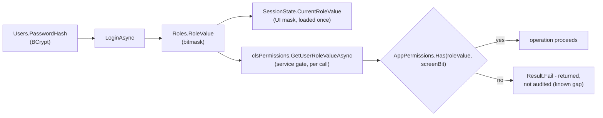
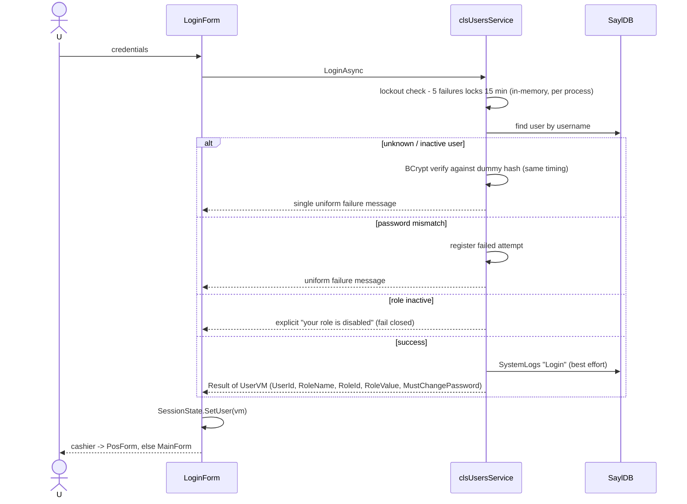

# Authentication and Authorization — SaylPOS

How SaylPOS identifies users, decides what they may do, and audits what they did.

## 1. Model Summary

- **Users** authenticate with username + password (BCrypt hashes in `Users.PasswordHash`).
- **Roles** hold a permission **bitmask** (`Roles.RoleValue`) — one fixed bit per
  administrative screen. Every user has exactly one role.
- **Three fixed roles** are seeded, protected from edit/deactivation, and identified
  by their value:

| Role | Value | Access |
|---|---|---|
| System Administrator (`مدير النظام`) | 4095 | All screens |
| Accountant (`محاسب`) | 508 | Everything except Products, Inventory, Users, Roles, Settings (i.e., customers, suppliers, invoices, expenses, reports, payroll) |
| Cashier (`كاشير`) | 0 | POS screen only — granted **by role identity**, not by a bit |

- **Custom roles** are capped at `3071` (everything except the Roles screen): the
  Roles bit (1024) never appears in the role editor, so administrator supremacy is
  guaranteed by construction, not by checking.

## 2. Screen Permission Bits (`Common.Utils.AppPermissions`)

| Bit | Value | Screen |
|---|---|---|
| Products | 1 | Products |
| Inventory | 2 | Inventory (receive, adjust, transfer, stock count, fiscal close) |
| Customers | 4 | Customers (incl. collections) |
| Suppliers | 8 | Suppliers (incl. supplier payments) |
| SalesInvoices | 16 | Sales invoices (discounts above 10 %, suspended-invoice ownership override, invoice payments) |
| PurchaseInvoices | 32 | Purchase invoices (creation, payments, supplier returns) |
| Expenses | 64 | Expenses |
| Reports | 128 | Reports |
| Employees | 256 | Employees and payroll |
| Users | 512 | Users |
| Roles | 1024 | Roles (administrator only, never editable) |
| Settings | 2048 | Settings (incl. database restore) |

The bit positions are a frozen contract: stored `RoleValue` values in the database
must keep meaning the same screens forever; new screens take the next free bit, and
deleted screens' bits are never reused.

## 3. Authentication Flow

`clsUsersService.LoginAsync(username, password)`:

Details:

- **Timing equalization:** unknown or inactive usernames still run a BCrypt verify
  against a dummy hash, so response timing cannot enumerate accounts, and all
  credential failures share one message.
- **Lockout:** 5 failed attempts lock the username for 15 minutes (in-memory — resets
  on process restart; acceptable for the single-machine deployment).
- **Password policy:** `ValidatePasswordPolicy` enforces strength rules; the default
  admin is created with `MustChangePassword = 1` and cannot proceed until the password
  is changed. Password changes verify the old password; admin reset bypasses it and is
  authorized/audited.
- **First-run bootstrap:** with zero active users, startup creates the default
  `admin` account (no interactive setup screen; no accounts are seeded by the SQL
  script).
- **Logout** writes a `SystemLogs` row and clears `SessionState`.

## 4. Authorization Enforcement

The core principle: **the UI hides, the service enforces.**

- `SessionState.Can(bit)` filters which sections/buttons a user sees — cosmetic only.
- Every state-changing service operation performs its own check as its first step:
  `clsPermissions.GetUserRoleValueAsync(actorUserId)` returns the role value of an
  active user with an active role, or `-1` (which owns no bits and is not the cashier
  identity) — so missing identity, inactive users and inactive roles all fail closed.
- Examples of gates beyond the simple screen bits:

| Operation | Extra rule |
|---|---|
| POS discounts > 10 % or any amount discount, or an under-priced unit | Sales Invoices bit |
| Complete/cancel another cashier's suspended invoice | Sales Invoices bit (owner always may) |
| Pay an invoice | Sales Invoices bit (sale side) / Purchase Invoices bit (purchase side) |
| Collect from a customer / pay a supplier | Customers / Suppliers bit |
| Customer return | Cashier identity or Sales Invoices bit; supplier return: Purchase Invoices bit |
| Stock receive/adjust/transfer, count sessions, fiscal-year close | Inventory bit |
| Database restore | Settings bit (commit f6a57b4) |
| Close another user's drawer session | Admin only |

- **Drawer-session validation** (`ValidateDrawerSessionAsync`): any cash-bearing
  operation directed at a drawer requires that the session exists, is open, and is
  owned by the actor (admins may cross ownership). `SessionId = null` means "no
  drawer" and never bypasses the permission bits.

## 5. Role Management Rules

`clsRoleService` protects the model:

- The three fixed roles cannot be edited or deactivated.
- Custom roles are limited to `CustomRoleCeiling` (3071).
- Role changes on users (`ChangeRoleAsync`) are authorized and audited; deactivating a
  role immediately revokes all its users' access (fail-closed at login and at every
  service check).

## 6. Audit Trail

`clsAudit.Log` writes `SystemLogs` rows for: login/logout, sale/suspend/complete/cancel
invoices, stock adjustments, batch transfers, stock-count sessions (open/post),
fiscal-year closes, user/role changes, and restore start/completion.

Known gaps (documented, deliberate scope):

- **Denied authorization attempts are not audited** — failures are returned but not
  logged.
- The login lockout state is in-memory per process.
- `SystemLogs` has no built-in retention or purge job.

## 7. Licensing (Separate From Authorization)

Product licensing is orthogonal to user authorization: `PosLicensing` validates an
offline RSA-2048, machine-fingerprint-bound license at startup
(`LicenseGate.EnsureValidated`, fail-closed, distinguishes expiry / clock rollback /
transient unavailability). It gates *running the product*; `AppPermissions` gates
*what a signed-in user may do*. `KeygenTool` is the vendor-only license issuer and is
never shipped.

## 8. Known Limitation: Client-Supplied Identity (A3)

Every service method receives the acting user's `userId` as a parameter. There is no
server-side session or token: within the supported single-machine (or trusted-LAN
terminal) deployment, the application process is the trust boundary. Any future
multi-terminal or server-hosted design must replace this with an authenticated
identity before the service layer can be considered a security boundary against a
malicious client. This is the audit's A3 finding and remains an open design item.

