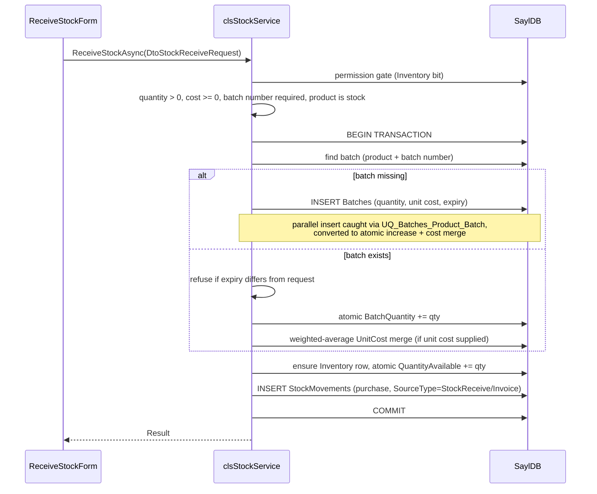

# Inventory Workflow — SaylPOS

Covers product management, stock receipt, manual adjustments, batch transfer, the
reservation model, and how batch costing works. The physical count cycle lives in
[STOCK_COUNT_WORKFLOW.md](STOCK_COUNT_WORKFLOW.md).

## 1. Participants

| Role | Component |
|---|---|
| UI | `ProductsControl`, `InventoryControl`, `ProductEditForm`, `ReceiveStockForm`, `AdjustStockForm`, `LabelPrintForm` |
| Services | `clsProductService`, `clsStockService`, `clsStockCountService` (posting), `clsReportService` (valuation) |
| Data | `Products`, `Batches`, `Inventory`, `StockMovements`, `StockReservations`, `SystemLogs` |

## 2. Product Management

### Create / update
`clsProductService.AddNewProductAsync` / `UpdateProductAsync` (Products screen bit,
`AppPermissions.Products`, checked at the service boundary).

- Fields: name, barcode (unique when present), unit, type (`stock`, `service`,
  `manufactured`), `BasePrice` (sell price), `CostPrice` (last-purchase reference),
  reorder level, active flag.
- Barcode lookup runs through `GetProductByBarcodeAsync`; the comparison follows the
  database collation (case-insensitive on default SQL Server installs), and only
  active products match.

### Net-available quantity
`GetNetAvailableQuantityAsync` / `GetNetAvailableQuantitiesAsync` define the
application-wide sellability rule:

```
net available = Σ BatchQuantity of non-expired, non-quarantined batches
                − QuantityReserved        (floored at zero)
```

This is the basis for POS availability, low-stock indicators (threshold: net
available ≤ reorder level) and the inventory status report. `Inventory.QuantityAvailable`
alone is not the sellable figure — reserved units are excluded explicitly.

### Deactivation
`DeactivateProductAsync` / `ActivateProductAsync` — soft deactivation only; products
are never deleted, preserving invoice and movement history.

## 3. Stock Receipt

`clsStockService.ReceiveStockAsync` (Inventory screen bit required):



Cost merge rules (`MergeReceiveCostAsync`, same equation as purchase and transfer):

- Incoming cost `null` → not called; existing batch cost untouched.
- Batch cost `null` or batch quantity ≤ incoming quantity → batch takes the incoming
  cost.
- Otherwise → `ROUND((UnitCost × (Qty − incoming) + incomingCost × incoming) / Qty, 2)`,
  computed **after** the quantity increase.

## 4. Stock Adjustments

`clsStockService.AdjustStockAsync` (Inventory screen bit required; quantity > 0 and a
reason are mandatory).

### Increase

- With a batch number: same find-or-create + expiry-conflict + atomic-increase rules
  as receipt.
- Without a batch number: an **automatic batch** `ADJ-yyyyMMdd-HHmmss` is created
  (no cost). Rationale: deductions only run through batches, so stock without a batch
  would never be sellable; the auto batch keeps `Σ batch quantities = available`.
- Inventory increase is atomic and sets `LastCountedAt`.

### Decrease

- With a batch number: deduct from that batch only (quantity guard).
- Without a batch number: consume batches **FEFO** — earliest expiry first (null
  expiry last), then quarantined first, then oldest created; one `StockMovements`
  (`adjustment_out`) row per batch actually deducted, all with
  `SourceType = 'ManualAdjustment'` and `SourceId` = the caller's id (the stock-count
  line id when posting a count). Insufficient total → refusal.

### Audit

Every adjustment writes a `SystemLogs` row (`StockAdjustment`) with product, direction,
quantity and reason.

## 5. Batch Transfer

`clsStockService.TransferBatchAsync` moves quantity between two batches of the same
product (Serializable transaction):

- Source quantity guarded by a conditional atomic decrement
  (`AND BatchQuantity >= @qty`) — parallel transfers cannot oversell the source.
- Target find-or-create with the same unique-index catch-and-merge pattern.
- Merging into an existing target is refused when expiry dates differ or when the
  quarantine states differ (quarantined stock must not silently become sellable; a
  controlled re-labelling requires a new batch number and is audited).
- Cost travels with the quantity: the target batch is created with the source's
  `UnitCost`, and merges apply `MergeTransferCostAsync` (weighted average, null-safe).
- Two `StockMovements` rows (`adjustment_out` on source, `adjustment_in` on target,
  `SourceType = 'BatchTransfer'`, each carrying the other batch as `SourceId`) plus a
  `SystemLogs` audit row.

## 6. Quarantine and Expiry

- `Batches.IsQuarantined` marks stock that physically exists but must not be sold
  (e.g., expired returns). Quarantined batches are excluded from sale FEFO selection
  and from net-available; they remain included in total valuation.
- FEFO expiry comparison uses the program day (`ProgramClock.Today`, UTC+3), so a
  batch expiring yesterday is unsellable from the first program minute of today.
- The dashboard and reports surface expiring batches (`GetExpiringBatchesAsync`,
  default window 90 days).

## 7. Reservation Model (suspended invoices)

- Suspending a POS invoice creates `StockReservations` rows and increases
  `Inventory.QuantityReserved` without touching `QuantityAvailable` or batches.
- Completing the invoice deducts stock and consumes its own reservation rows;
  cancelling releases them. No other invoice's reservations are ever modified.
- `UQ_StockReservations_Invoice_Product` prevents duplicate reservations under
  parallelism.

## 8. Movement Audit Trail

Every quantity change writes `StockMovements`:

| MovementType | Direction | SourceType / SourceId |
|---|---|---|
| `purchase` | + | `Invoice` + purchase invoice id, or `StockReceive` |
| `sale` | − | `Invoice` + sale invoice id, or `StockSale` |
| `customer_return` | + | `Invoice` + return invoice id |
| `supplier_return` | − | `Invoice` + return invoice id |
| `adjustment_in` / `adjustment_out` | ± | `ManualAdjustment` + count line id, or `BatchTransfer` |

This log is the provenance used for stock-count reconciliation, valuation and
debugging; it is append-only and never edited.


