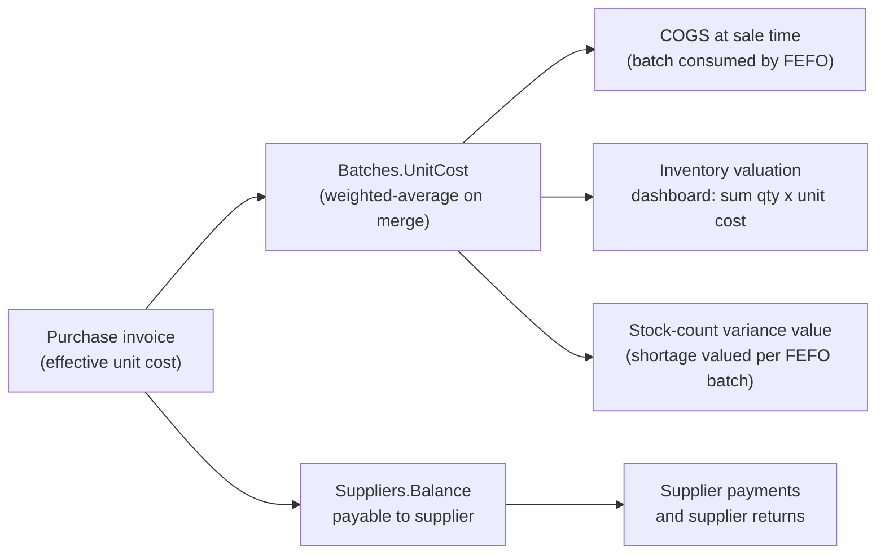

# Purchase Workflow — SaylPOS

Covers creating purchase invoices (the primary stock intake path), batch costing,
and the supplier side of payments/returns. Purchasing feeds the batch costs that
later drive COGS in sales and the fiscal-year inventory valuation.

## 1. Participants

| Role | Component |
|---|---|
| UI | `InvoicesControl(enInvoicesType.purchase)` section, `PurchaseForm`, `SupplierPaymentForm`, `SupplierReturnForm` |
| Services | `clsPurchaseService`, `clsPaymentService`, `clsReturnService`, `clsSupplierService`, `clsPartyService` |
| Data | `Invoices`, `InvoiceItems`, `Batches`, `Inventory`, `StockMovements`, `Payments`, `Suppliers`, `SystemLogs` |

## 2. Authorization

`clsPurchaseService.CreatePurchaseInvoiceAsync` requires the **Purchase Invoices**
screen bit (`AppPermissions.PurchaseInvoices`) at the service boundary — creating a
purchase invoice moves money (supplier balance), stock and cost prices, so hiding the
screen in the UI is not sufficient. Paying a purchase invoice also requires the same
bit (see [PAYMENTS_AND_RETURNS.md](PAYMENTS_AND_RETURNS.md)).

## 3. Purchase Invoice Creation

### User action
In `PurchaseForm`: choose supplier, add line items (product, quantity, unit cost,
**batch number**, optional expiry date), optionally an invoice-level discount and tax
percent, optionally an immediate payment, confirm.

### Validation (service-level)

- At least one item; quantity > 0; unit cost ≥ 0; a batch number for every item.
- Supplier must exist; products must be of type `stock`.
- Amount guards: discount between 0 and total; tax 0–100 %; immediate payment between
  0 and total (no over-payment); net ≥ 0.

### Execution (single transaction, default isolation)

1. Compute totals: `total = Σ(unitCost × qty)`, `discount` (rounded once), tax on the
   discounted base, `net = total − discount + tax`.
2. **Discount allocation across items** (`AllocateDiscountAcrossItems` — pure static
   function, unit-tested directly): each item's share of the discount is proportional
   to its gross value; the largest-remainder rule distributes leftover cents so the
   allocations sum to the discount exactly. Each item's
   `EffectiveUnitCost = (gross − share) / quantity`.
3. Insert the `Invoices` header (`Type = 'purchase'`, `PartyType = 'S'`).
4. Per item:
   - Find or create the `Batches` row (`UQ_Batches_Product_Batch` guards parallel
     creation; a competing insert is caught and converted into an atomic quantity
     increase).
   - Expiry incompatibility is refused: merging quantities with a different expiry
     date is not allowed — a new batch number is required (protects FEFO history).
   - Existing batch: atomic `BatchQuantity += qty` plus **quantity-weighted average**
     cost merge (`Batches.UnitCost`).
   - Insert `InvoiceItems` (`ItemPrice` = raw cost as historical record;
     `ItemCost` = effective net cost).
   - Ensure the `Inventory` row exists, then atomic
     `QuantityAvailable += qty`.
   - Insert `StockMovements` (`purchase`, `SourceType = 'Invoice'`,
     `SourceId = invoiceId`).
   - Update `Product.CostPrice` to the effective unit cost (display/last-purchase
     reference only — not the COGS source).
5. Optional immediate payment: insert `Payments` (`outcome`), set `PaymentStatus`.
6. Atomic supplier balance update: `Balance += net − paid`.
7. Commit.

### Database changes

| Table | Change |
|---|---|
| `Invoices` | +1 row (`purchase`) |
| `InvoiceItems` | +1 row per item |
| `Batches` | new rows or quantity/cost merges |
| `Inventory` | `QuantityAvailable += qty` per item |
| `StockMovements` | +1 row per item (`purchase`) |
| `Payments` | +1 row if paid immediately |
| `Suppliers` | `Balance += net − paid` |

### Failure scenarios

- Expiry-date conflict on an existing batch number → refusal (use a new batch).
- Amount-guard violations → refusal with the specific message.
- Parallel purchase of the same new batch → unique-index catch, merged safely.
- Any exception → rollback; nothing persisted.

## 4. Manual Stock Receive

`clsStockService.ReceiveStockAsync` (Inventory screen bit required) performs the same
batch intake without an invoice: find-or-create batch (with the same expiry-conflict
rule), atomic quantity increase, weighted-average cost merge when a unit cost is
supplied, atomic inventory increase, and a `StockMovements` row with
`SourceType = 'StockReceive'`. It is used for opening balances and ad-hoc intake.

## 5. How Purchasing Feeds the Rest

- **COGS:** sales consume batches FEFO; each consumed batch contributes its own
  `UnitCost` (fallback `Product.CostPrice` only for costless batches — documented
  reserve). See [COSTING.md](../COSTING.md).
- **Fiscal close:** purchase debts and payables participate in close-readiness
  (outstanding computed with the allocation engine) — see
  [FISCAL_CLOSING.md](FISCAL_CLOSING.md).

## 6. Supplier Management

- `clsPartyService` / `clsSupplierService`: create/update/deactivate suppliers
  (`PartyType = 'S'` or `'B'`), with the Suppliers screen bit required at the service
  boundary. Balances are maintained by purchases, payments and supplier returns;
  `CK_Suppliers_NonNegativeBalance` keeps the balance non-negative.

