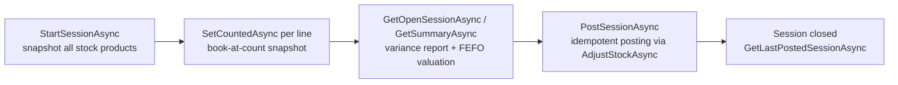
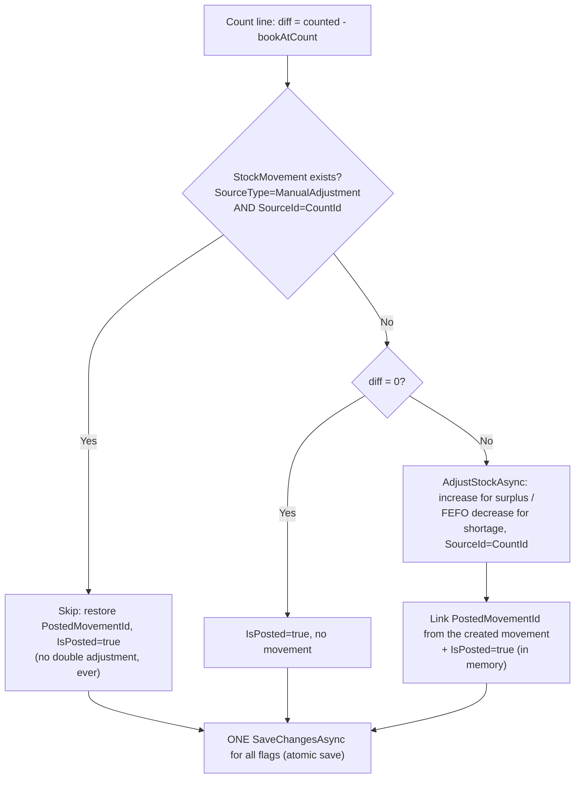

# Stock Count Workflow — SaylPOS

The physical inventory count cycle: open a session, count lines, review variances,
and post the differences. Posting is **idempotent** — a partial failure is always safe
to retry without any double adjustment.

## 1. Participants

| Role | Component |
|---|---|
| UI | `InventoryControl`, `StockCountForm` |
| Services | `clsStockCountService` (session lifecycle, variance valuation, posting), `clsStockService.AdjustStockAsync` (the actual adjustment) |
| Data | `StockCounts`, `Products`, `Batches`, `Inventory`, `StockMovements`, `SystemLogs` |

## 2. Authorization

Every stock-count operation requires the **Inventory** screen bit
(`AppPermissions.Inventory`) — enforced inside `clsStockCountService`
(`CheckInventoryPermissionAsync` via `clsPermissions.GetUserRoleValueAsync`), not just
hidden in the UI. Direct service calls cannot bypass the gate. The same bit is
required by `AdjustStockAsync`, so direct and indirect (posting) callers share one
policy. `GetUserRoleValueAsync` refuses: identity ≤ 0, unknown user, inactive user, or
inactive role.

## 3. Cycle Overview

## 4. Opening a Session — `StartSessionAsync(userId)`

- Permission gate, then a Serializable transaction with
  `sp_getapplock @Resource = 'StockCountSession'` (transaction owner) so two parallel
  opens serialize.
- Refuses if an open session exists (`HasOpenSessionAsync`) or there are no active
  stock products.
- Snapshots **every active stock product**: `BookQuantity` (system quantity at
  session start), `UnitCost` (last purchase price — historical display only), product
  name snapshot, `CountedBy`, `CreatedAt` (UTC).
- `CountSessionId` = previous max + 1, generated inside the lock so it never
  duplicates.
- One guard at the database level: `UQ_StockCounts_OpenProduct` — a filtered unique
  index on `ProductId WHERE IsPosted = 0`, preventing two parallel open sessions for
  the same product even if the app check were bypassed.

## 5. Counting a Line — `SetCountedAsync(countId, counted, actorUserId)`

- Permission gate; then a session-owned app lock (`StockCountPost`) prevents editing
  lines while a post is running.
- Refuses: line missing, line already posted, negative counted quantity.
- On counting: snapshots `BookQuantityAtCount` (system quantity read from the
  database **at the moment of counting**, `AsNoTracking`) and `CountedAt`
  (UTC), then stores `CountedQuantity`.
- On clearing the count: the three fields return to `null`.
- Re-counting a line takes a fresh snapshot at the new moment.

The book-at-count snapshot is what makes the cycle correct under activity: the
difference is `counted − bookAtCount`, so movements (sales, receipts, adjustments)
that happen **after** counting are preserved in the final balance.

## 6. Variance Reporting — `GetOpenSessionAsync` / `GetSummaryAsync`

Per line:

- Uncounted lines display the live book quantity (session snapshot + net movements
  since session start).
- Counted lines display `BookQuantityAtCount` and the difference
  `counted − bookAtCount` — exactly what posting will apply.

Valuation (`ComputeVarianceValue` — the single source of the equation):

- **Shortage** (diff < 0): valued by simulating the same FEFO consumption the posting
  will perform — `Σ(take from batch × (batch.UnitCost ?? product.CostPrice))`.
- **Surplus** (diff > 0): valued as `diff × Product.CostPrice` (the posting creates an
  auto batch with no cost, so later consumption falls back to the product cost — the
  documented reserve, no invented cost).
- **Insufficient batches**: the pre-estimate uses `Product.CostPrice` explicitly for
  the remainder (the post itself would fail).
- `StockCounts.UnitCost` (last-purchase price at session start) is display-only and is
  never used for valuation.

The summary aggregates total/counted/uncounted lines, net and absolute differences,
cost of differences, and surplus/shortage/matched counts.

## 7. Posting — `PostSessionAsync(userId)`

- Permission gate **before** locking or checking lines (a session with all-zero
  differences still counts as a state change and requires the bit).
- Session-owned app lock (`StockCountPost`); refuses if a post is already running.
- Refuses if any line is uncounted (count it, or set it to zero to post a book-
  quantity reconciliation).
- For each unposted line, in order:

Idempotency contract:

1. **Idempotency key:** every posting adjustment writes
   `StockMovements.SourceType = 'ManualAdjustment'` with `SourceId = CountId`
   (commit b6e5993). A shortage line may produce several movements (one per FEFO
   batch), which is why the support index
   `IX_StockMovements_ManualAdjustmentSource` is filtered and non-unique.
2. **Database-backed check:** before posting a line the service queries the database
   (not memory) for an existing movement with that key — safe across retries and app
   restarts.
3. **Durable link:** `StockCounts.PostedMovementId` records the movement created for
   each line, set immediately after a successful adjustment and before the save.
4. **Atomic flag save:** all `IsPosted` / `PostedMovementId` values are written in a
   single `SaveChangesAsync`; if a later line fails, earlier lines are already marked
   and the retry skips them.

Failure behavior: the first failing line stops the run with a per-product message;
posted lines keep their markers, and re-invoking `PostSessionAsync` resumes safely.

## 8. After Posting

- `GetLastPostedSessionAsync` shows the posted session's lines and their **actual**
  variance cost, computed from the real adjustment movements (per-batch unit cost,
  fallback `Product.CostPrice`), which matches the movement history exactly.
- `AdjustStockAsync` sets `Inventory.LastCountedAt` on decreases.
- An open (unposted) stock-count session blocks the annual fiscal close (see
  [FISCAL_CLOSING.md](FISCAL_CLOSING.md)).

## 9. Workflow Relationships

- Purchase receipts / manual adjustments feed the book quantities the count snapshots.
- Shortage postings consume batches FEFO, so the count interacts with costing
  ([COSTING.md](../COSTING.md)).
- Variance cost feeds the accounting picture summarized at fiscal close.

